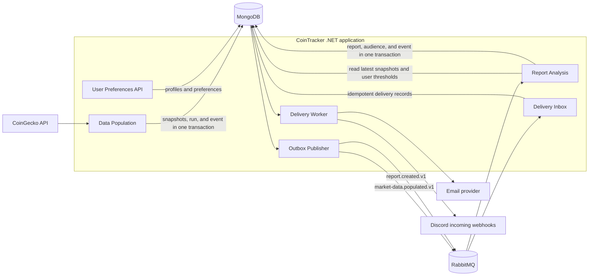

# CoinTracker

CoinTracker is a .NET 9 modular monolith that collects cryptocurrency market data, detects daily price movements, and delivers reports to users by email and Discord incoming webhooks.

## How it works



The app uses a MongoDB outbox so a database change and its outgoing event are persisted together. The outbox publisher sends events to RabbitMQ; consumers can safely handle duplicate events. MongoDB stores market snapshots, user profiles, reports, report audiences, delivery state, and outbox records. RabbitMQ carries workflow events, not application data storage.

The main event flow is:

- `market-data.populated.v1` starts report analysis after a successful market-data population.
- `report.created.v1` starts delivery for the report's saved audience.

## Modules

- **Data Population** fetches and validates market data, saves snapshots and ingestion results, and writes the population event to the outbox.
- **Report Analysis** reads the latest stored prices and user preferences. Its daily movement rule compares the latest price with earlier prices in the effective 24-hour window. Each favorite coin has its own threshold; there is no global threshold.
- **User Preferences** exposes the profile API and stores names, unique emails, favorite coins and thresholds, and up to five Discord webhook endpoints.
- **Delivery** snapshots eligible recipients into delivery records, then sends email and Discord notifications independently.
- **Shared Messaging and Persistence** provide the RabbitMQ event contracts, outbox publisher, MongoDB persistence, and idempotency support.

Email keeps the existing policy of five retries at 30-second intervals after the initial attempt. Discord requests use a 10-second timeout, `wait=true`, and count only HTTP 200 as success. Each Discord delivery gets at most one attempt; failed or interrupted attempts are not retried.

## User API

The API listens on port `8080` inside the container:

- `POST /api/users` creates a profile.
- `POST /api/users/lookup` accepts an email and returns the matching user ID.
- `GET /api/users/{userId}` reads a profile.
- `PUT /api/users/{userId}` updates a profile.

V1 has **no authentication or profile ownership checks**. Email lookup and user IDs are locators, not credentials. Keep the API on a trusted/private network; the supplied Compose files bind it to loopback on the host. Discord webhook URLs are credentials: the app encrypts them at rest using `USER_ENCRYPTION_KEY`, never returns their tokens, and must not log them.

## Run locally

Requirements: Docker Engine and Docker Compose v2.

The local stack is defined in [`compose.local.yaml`](compose.local.yaml). It builds the .NET app and runs local MongoDB (as a single-node replica set for transactions) and RabbitMQ containers.

Create or edit a root `.env` file (it is ignored by Git). Generate an encryption key once with `openssl rand -base64 32` and keep using the same value across restarts:

```dotenv
USER_ENCRYPTION_KEY=your-base64-encoded-32-byte-key
GECKO_API_KEY=your-coingecko-api-key
MAILJET_API_KEY=your-mailjet-api-key
SENDER_EMAIL=your-sender-email
SENDER_EMAIL_PASSWORD=your-sender-email-password
```

Start the stack from the repository root:

```bash
docker compose -f compose.local.yaml up --build -d
```

Check the app and logs:

```bash
curl http://localhost:8080/health
docker compose -f compose.local.yaml logs -f app
```

MongoDB and RabbitMQ are also exposed on the local machine for development tools. MongoDB uses port `27017`; RabbitMQ uses AMQP port `5672` and management UI port `15672`.

## Run on a VM

[`compose.yaml`](compose.yaml) runs the published app image and expects MongoDB and RabbitMQ connection strings from the environment. Make sure the image tag has been pushed to Docker Hub, then provide these variables in a private `.env` file on the VM:

```dotenv
IMAGE_TAG=latest
MONGO_CONNECTION_STRING=your-mongodb-connection-string
MONGO_DATABASE_NAME=CoinsDB
RABBITMQ_CONNECTION_STRING=your-amqp-or-amqps-connection-string
USER_ENCRYPTION_KEY=the-same-stable-base64-key
GECKO_API_KEY=your-coingecko-api-key
MAILJET_API_KEY=your-mailjet-api-key
SENDER_EMAIL=your-sender-email
SENDER_EMAIL_PASSWORD=your-sender-email-password
```

Then pull and start the app:

```bash
docker compose pull
docker compose up -d
docker compose logs -f app
```

Build and push an image for an x86-64 Linux VM from the repository root:

```bash
docker buildx build --platform linux/amd64 -t kiszewski/cointracker:latest --push .
```

The VM Compose file binds port `8080` to `127.0.0.1`; use a private network or a secured reverse proxy if remote access is required. Do not expose the unauthenticated profile API publicly.

## Configuration

The app reads standard .NET environment variables. The local Compose file supplies MongoDB and RabbitMQ settings for its containers. The VM Compose file takes `MONGO_CONNECTION_STRING`, `RABBITMQ_CONNECTION_STRING`, and `USER_ENCRYPTION_KEY` from its environment; provider and email settings can also be supplied there.

Important settings:

- `MarketData__ApiKey` and `MarketData__PopulationIntervalMinutes` configure CoinGecko access and the population schedule (15 minutes by default).
- `Analysis__LookbackHours` controls the lookback (24 hours by default).
- `RabbitMq__RetryCount` and `RabbitMq__RetryIntervalSeconds` are fixed at five retries and 30 seconds for event processing.
- `UserSecrets__EncryptionKey` must be a stable base64-encoded 32-byte key. Back it up securely; losing or changing it makes stored Discord URLs unreadable.

## Project layout

```text
Modules/                 Ingestion, Reporting, Delivery, and Users
Infrastructure/          Typed configuration and MongoDB persistence
Shared/Messaging/        Event contracts, RabbitMQ consumers, and outbox publisher
Shared/Observability/    Metrics and RabbitMQ queue metrics
specs/                   Product specs, technical plans, and implementation tasks
compose.local.yaml       Local app + MongoDB + RabbitMQ stack
compose.yaml             VM app deployment using external MongoDB and RabbitMQ
```
